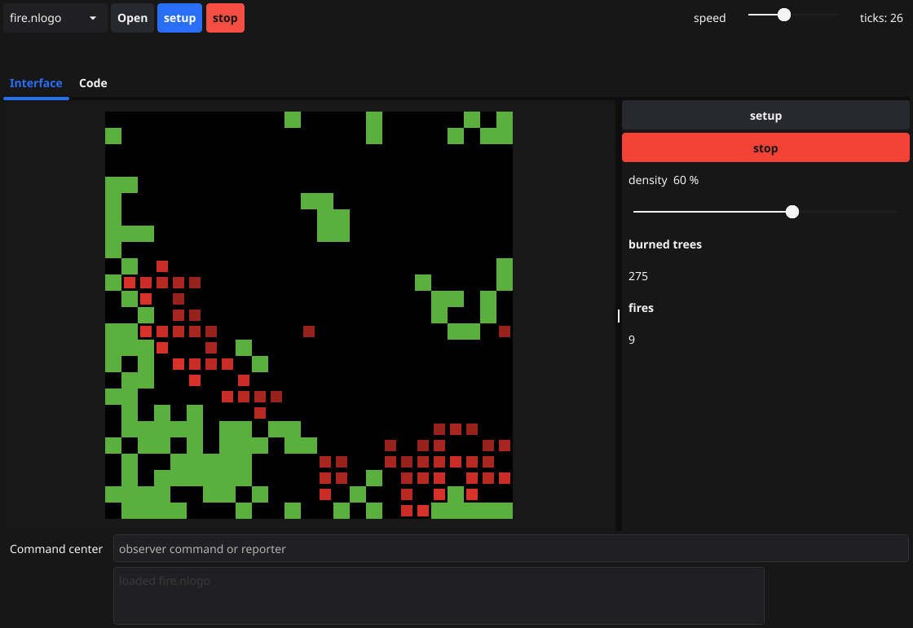

# GoNetLogo

GoNetLogo is a desktop agent-based modeling environment written in Go. It is a from-scratch reimplementation of a working subset of [NetLogo](https://www.netlogo.org/), enough to edit a model, run it, and watch the world.

NetLogo was created by Uri Wilensky at the Center for Connected Learning and Computer-Based Modeling (CCL), Northwestern University. The language, the world topology, the color model, and the `.nlogo` / `.nlogox` widget layout implemented here follow that design. This program is a derivative work of the NetLogo source (GPL-2.0-or-later) and is released under the **GNU General Public License, version 2 or any later version**. See `LICENSE`.

```
GoNetLogo
Copyright (C) 2026

This program is free software; you can redistribute it and/or modify
it under the terms of the GNU General Public License as published by
the Free Software Foundation; either version 2 of the License, or
(at your option) any later version.
```

NetLogo itself:

```
NetLogo
Copyright (C) 1999-2026 Uri Wilensky

https://www.netlogo.org
https://github.com/NetLogo/NetLogo
```

Commercial licenses of NetLogo remain available from Uri Wilensky. This port does not change that.

## Build and run

Go 1.22 or newer. The window toolkit uses cgo, so a C compiler and the usual OpenGL / X11 headers are required on Linux (`build-essential`, `libgl1-mesa-dev`, `libx11-dev`, `libxrandr-dev`, `libxinerama-dev`, `libxcursor-dev`, `libxi-dev`).

```bash
go test ./...
go vet ./...
go build -o gonetlogo ./cmd/gonetlogo
./gonetlogo
```

The window opens on the forest-fire demo. Use the model menu for Game of Life, Termites, and Wolf Sheep. **setup** runs once. **go** is a forever button: click it again to stop. The speed slider slows the loop below the midpoint and runs extra steps per frame above it. The command center accepts one observer command or reporter at a time. The Code tab edits the program; **Apply code** recompiles and rebuilds the world, and you press setup again.

Open a `.nlogo` or `.nlogox` file with **Open**. The code section, the view, and basic widgets are loaded. Plots are skipped and named in the status line.

Browser preview of the same interpreter (the desktop window cannot be embedded in a browser pane):

```bash
./gonetlogo -web 127.0.0.1:43127
```

Then open that address. Setup runs when a model loads, and go starts on the first model.

Headless still of the interface, after `setup` and 30 `go` steps:

```bash
./gonetlogo -snapshot fire.png -model fire.nlogo -steps 30 -seed 1
```

`-model` is a built-in name (`fire`, `life`, `termites`, `wolfsheep`) or a path. `-seed 0` keeps a clock seed.



## Why Fyne

The shell is [Fyne](https://fyne.io) (`fyne.io/fyne/v2`). NetLogo's interface is a widget desktop: an editor, buttons, sliders, switches, monitors, a chooser, and a 2D world. Fyne supplies those controls in Go and is cross-platform (Windows, macOS, Linux). `canvas.Raster` is the world: the interpreter paints patches and turtles into an image, and the raster scales it with nearest-neighbor pixels so the grid stays crisp. Ebitengine is a better fit for a game loop and a worse fit for this many standard controls. Gio would mean building the editor, sliders, and tabs by hand.

## Architecture

```
cmd/gonetlogo          window, or -snapshot
internal/gui           Fyne shell: view, interface, code, command center
internal/nl            lexer, parser, interpreter, world, file loader, renderer
models                 original demo programs (embedded)
```

The interpreter is a tree walk, not a bytecode compiler.

- The lexer follows NetLogo's identifier rules. `x-1` is one name; subtraction is `x - 1`. A number that runs into identifier characters (`1-2`) is an error. `;` comments run to end of line. Strings use `\"`, `\\`, `\n`, `\t`, and `\r`. Names are case-insensitive.
- The parser is precedence-driven, in the same spirit as NetLogo's expression parser. `with` binds tighter than `count`, so `count turtles with [color = red]` is `count (turtles with [...])`. `of` is right-associative. `not` binds tighter than `=`. Reporter arguments are parsed at the reporter's precedence, so infix operators looser than the call stay outside it. Command arguments are parsed loosely, so `fd 1 + 2` moves 3.
- `ask` snapshots the agentset, shuffles it with the world RNG, and does not visit agents created during the ask. Only the observer may `ask turtles` or `ask patches`. A breed set is allowed from any context.
- `stop` leaves the current procedure. A procedure called directly from a button stops that button. `stop` inside `ask` skips the rest of that agent's commands only.
- `die` removes a turtle and its links, or a link, and skips the rest of that agent's current block. Patches cannot die.
- `let` lives in the current block and is visible to nested blocks in the same procedure. A called procedure does not see the caller's locals. Tasks close over the scope they were created in.

### World

Patches form a grid. The default is `-16` to `16` on both axes, wrapping on both. A model's view widget can turn wrapping off per axis; a non-wrapping move that would leave the world is an error and does not move the turtle. Turtle coordinates wrap into `[minPcor - 0.5, maxPcor + 0.5)`. Patch coordinates use `floor(x + 0.5)`.

Heading `0` is north and headings increase clockwise. `forward d` adds `d * sin(heading)` to `xcor` and `d * cos(heading)` to `ycor`.

Turtles carry `who`, `heading`, `xcor`, `ycor`, `color`, `shape`, `size`, `hidden?`, `label`, and breed variables. `who` numbers are never reused. Patches carry `pcolor`, `pxcor`, `pycor`, `plabel`, and `patches-own` variables. A turtle reads and writes the variables of the patch it stands on. Links have endpoints, a direction, color, shape, thickness, and `links-own` variables. `die` on a turtle removes its links.

`clear-all` clears globals, ticks, turtles, links, patches, and the drawing layer. Slider, switch, chooser, and input variables are interface globals and are left alone. `reset-ticks` starts the counter at 0. `tick` and `ticks` fail until then.

`random` and `random-float` use `math/rand` with an explicit seed. `random-seed` is deterministic inside this program. The generator is not NetLogo's Mersenne Twister, so the same seed does not reproduce a NetLogo run bit for bit. `clear-all` does not reseed.

Colors are NetLogo numbers in `[0, 140)`, with the fourteen base hues and the same shade ramp (black is 0, white is 9.9). `scale-color` follows the NetLogo primitive. An RGB list is accepted as a color.

## Demo models

`models/` holds four original programs. They implement well-known rules and are not copies of the Models Library. Those library files are published under CC BY-NC-SA and are not included here. If you have them, **Open** loads the code section and the basic widgets.

| Model | What it shows |
| --- | --- |
| `fire.nlogo` | Percolation on `neighbors4`. A fire ignites green orthogonal neighbors, becomes an ember, and cools. Density is a slider. |
| `life.nlogo` | Conway's Life on patches. Counts are taken before any cell updates. **blinker** builds a period-2 oscillator. |
| `termites.nlogo` | Termites pick up yellow chips and drop them on empty patches. The chip count (patches plus carriers) is constant. |
| `wolfsheep.nlogo` | Sheep eat grass, wolves eat sheep, both spend energy, reproduce by `hatch`, and die at zero. A switch turns grass off. |

`go test` covers the lexer, parser, arithmetic, lists, tasks, movement and wrapping, breeds and links, diffuse, and these models: the blinker returns to its start after two ticks, a fully planted forest burns out, and termites conserve chips.

## Primitives in this milestone

Special forms: `to`, `to-report`, `end`, `globals`, `turtles-own`, `patches-own`, `links-own`, `breed`, `directed-link-breed`, `undirected-link-breed`, `<breed>-own`, `let`, `set` (including `set [x y] [1 2]`), `if`, `ifelse`, `while`, `repeat`, `loop`, `ask`, `foreach`, `report`, `stop`.

Commands: `clear-all` (`ca`), `clear-turtles` (`ct`), `clear-patches` (`cp`), `clear-globals`, `clear-links`, `clear-ticks`, `clear-drawing` (`cd`), `clear-output`, `reset-ticks`, `tick`, `tick-advance`, `random-seed`, `die`, `forward` (`fd`), `back` (`bk`), `jump`, `right` (`rt`), `left` (`lt`), `setxy`, `facexy`, `face`, `home`, `pen-down` (`pd`), `pen-up` (`pu`), `hide-turtle` (`ht`), `show-turtle` (`st`), `print`, `show`, `type`, `write`, `output-print`, `output-show`, `user-message`, `resize-world`, `set-default-shape`, `set-patch-size`, `diffuse`, `diffuse4`, `create-turtles` (`crt`), `create-ordered-turtles` (`cro`), `sprout`, `hatch`, the breed-specific forms of those four, `create-link-with` / `to` / `from` and the plural and breed-specific forms, `layout-circle`, `run`, `display`, `no-display`, `reset-timer`, `wait` (capped at 5 seconds), `beep`.

Reporters: `turtle`, `patch`, `link`, `turtles-on`, `turtles-at`, `patch-here`, `patch-ahead`, `patch-at`, `patch-left-and-ahead`, `patch-right-and-ahead`, `turtles-here`, breed sets, `<breed>-here`, `<breed>-on`, `<breed>-at`, `is-<breed>?`, `one-of`, `n-of`, `any?`, `all?`, `count`, `sum`, `mean`, `max`, `min`, `variance`, `standard-deviation`, `max-one-of`, `min-one-of`, `with`, `with-min`, `with-max`, `in-radius`, `of`, `other`, `neighbors`, `neighbors4`, `distance`, `distancexy`, `towards`, `towardsxy`, `can-move?`, `myself`, `self`, `map`, `filter`, `reduce`, `n-values`, `foreach` tasks, `range`, `list`, `sentence` (`se`), `fput`, `lput`, `but-first` (`bf`), `but-last` (`bl`), `first`, `last`, `item`, `length`, `empty?`, `member?`, `position`, `reverse`, `sort`, `sort-by`, `sort-on`, `remove`, `remove-item`, `replace-item`, `sublist`, `substring`, `word`, `read-from-string`, `random`, `random-float`, `random-xcor`, `random-ycor`, `random-pxcor`, `random-pycor`, `scale-color`, `shade-of?`, color names, `not`, `and`, `or`, `xor`, arithmetic and comparisons, `abs`, `round`, `floor`, `ceiling`, `int`, `precision`, `approximate`, `sqrt`, `sin`, `cos`, `tan`, `asin`, `acos`, `atan`, `ln`, `log`, `exp`, `mod`, `remainder`, `ifelse-value`, `runresult`, `is-number?`, `is-string?`, `is-list?`, `is-boolean?`, `is-agent?`, `is-turtle?`, `is-patch?`, `is-link?`, `is-nobody?`, `is-agentset?` and the three agentset variants, `turtle-set`, `patch-set`, `link-set`, `link`, `in-link-from`, `out-link-to`, `link-with`, `link-neighbors`, `in-link-neighbors`, `out-link-neighbors`, `my-links`, `both-ends`, `ticks`, `timer`, `min-pxcor`, `max-pxcor`, `min-pycor`, `max-pycor`, `world-width`, `world-height`, `patch-size`.

Arrow tasks (`[x -> x + 1]`, `[[x y] -> ...]`) work. The old `?` task form works when a task is expected. Variadic reporters such as `list` and `word` need parentheses when they take more than two inputs, as in NetLogo.

## Roadmap

This is a first milestone. The language core and a usable desktop are in place. The rest of NetLogo is large; this is the order to take it:

1. **Plots and drawing.** Time-series plots, pen mode at a finer resolution than one sample per patch, and mouse reporters (`mouse-down?`, `mouse-xcor`) so models can draw on the view.
2. **NetLogo's RNG.** The Mersenne Twister NetLogo uses, so a seed matches an upstream run. Needed before any experiment tool is meaningful.
3. **The long tail of primitives.** `carefully`, `error`, `uphill`, tie and untie, `layout-spring`, `follow`, `watch`, `inspect`, output-widget commands, and file primitives (`file-open`, `file-read`).
4. **BehaviorSpace.** Parameter sweeps over the existing sliders, writing a table. Depends on the RNG if results are meant to match NetLogo.
5. **Extensions.** Honor the `extensions` declaration and load a small Go extension API. `nw`, `gis`, `table`, `array`, `matrix`, and `bitmap` are the ones models hit first.
6. **The rest of the interface.** A real Info tab, an output widget separate from the command center, a plot widget, chooser editing, the command-center history, and an agent inspector.
7. **System Dynamics.** The stock-and-flow diagram and its generated code.
8. **HubNet.** Participatory simulations. A large protocol; not required for single-player models.
9. **3D.** `turtles3d`, `pzcor`, and a second view. The world type would grow a Z axis; the renderer would need a new backend.
10. **LevelSpace, the controlling API, and the profiler.** Embedding one model in another, driving a model from outside the process, and primitive-level timing.

Also not in this milestone: NetLogo 3D worlds, the shape editor, bitmap import, the full widget geometry of the Interface tab (widgets here are a scrolling panel, not a free-form canvas), and concise anonymous syntax such as `map + [1 2] [3 4]` without an arrow.
