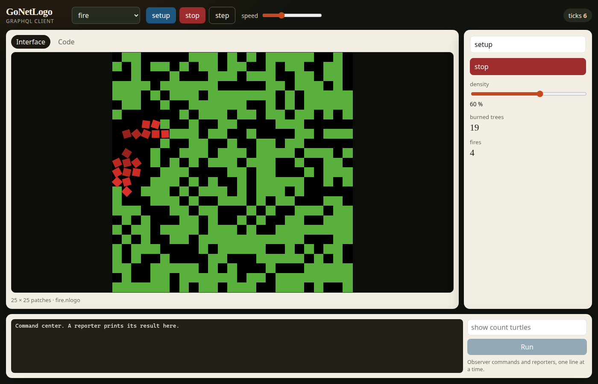

# GoNetLogo

GoNetLogo is an agent-based modeling environment written in Go. It is a from-scratch reimplementation of a working subset of [NetLogo](https://www.netlogo.org/): a language, a world, and an interface for editing a model and watching it run.

The language core is a Go package. The web UI is the client. It talks to that package through a GraphQL API.

NetLogo was created by Uri Wilensky at the Center for Connected Learning and Computer-Based Modeling (CCL), Northwestern University. The language, the world topology, the color model, and the `.nlogo` / `.nlogox` widget layout implemented here follow that design. This program is a derivative work of the NetLogo source (GPL-2.0-or-later) and is released under the **GNU General Public License, version 2 or any later version**. See `LICENSE`.

```
GoNetLogo
Copyright (C) 2026

This program is free software; you can redistribute it and/or modify
it under the terms of the GNU General Public License as published by
the Free Software Foundation; either version 2 of the License, or
(at your option) any later version.
```

NetLogo itself:

```
NetLogo
Copyright (C) 1999-2026 Uri Wilensky

https://www.netlogo.org
https://github.com/NetLogo/NetLogo
```

Commercial licenses of NetLogo remain available from Uri Wilensky. This port does not change that.

The running site is [https://gonetlogo.app.sapienexmachina.si](https://gonetlogo.app.sapienexmachina.si).

## Ubuntu native install

These scripts install, build, and run GoNetLogo on Ubuntu 22.04 or 24.04 without containers. The server is built with cgo off, so the scripts do not install a C toolchain or graphics libraries. Go comes from the official tarball when the copy on `PATH` is older than `go.mod`. Node.js 22 comes from nodejs.org when the installed Node is older than Vite needs. Anything already new enough is skipped, and sudo is used only for apt and for writing under `/usr/local`.

```bash
./setup.sh
./build.sh
./startup.sh
```

Open http://localhost:8080 . One process serves the web UI and `/graphql`, including websocket subscriptions. The GraphQL playground is at http://localhost:8080/playground . `-production` turns the playground off.

`PORT` and `HOST` change the listen address. The default is `127.0.0.1:8080`. The script passes those as `-addr`. Running `gonetlogo-server` itself, with `-addr` omitted, uses `ADDR` as a host:port listen address, or `PORT` as a port on the default host `0.0.0.0`. The `-addr` default stays `0.0.0.0:43131`. An explicit `-addr` wins over both.

```bash
PORT=9090 ./startup.sh
HOST=0.0.0.0 PORT=8080 ./startup.sh
```

### Logging

`gonetlogo-server` takes `-log-level`, `-log-format`, and `-log-file`.

| Flag | Values | Default |
| --- | --- | --- |
| `-log-level` | `debug`, `info`, `warn`, `error` | `info` |
| `-log-format` | `text`, `json` | `text` |
| `-log-file` | a path, or `-` for stderr | `-` (stderr) |

`GONETLOGO_LOG_LEVEL` sets the level when `-log-level` is omitted. `GONETLOGO_LOG_FILE` sets the file when `-log-file` is omitted. An explicit flag wins, including an invalid level or a path that cannot be opened. `warning` is accepted as an alias of `warn`. An unknown level or format, or a log file that cannot be opened, prints the error on stderr and exits 2. `-` and a blank value mean stderr. A real path is created if needed (mode `0644`) and opened for append. On a normal exit, and on SIGINT or SIGTERM, the file is flushed and closed. The server runs its drain first and does not re-raise the signal, so that work can finish and still write to the log. `startup.sh` does not forward extra arguments; it does pass the environment through, so `GONETLOGO_LOG_LEVEL=debug ./startup.sh` and `GONETLOGO_LOG_FILE=/tmp/gonetlogo.log ./startup.sh` work.

Lines from the standard `log` package go through the same logger. `log.Fatal` and a panic are also written to stderr, so the reason the process died stays on the terminal when the log file is somewhere else.

```bash
./bin/gonetlogo-server -log-level debug -log-format text -addr 127.0.0.1:8080
./bin/gonetlogo-server -log-file /var/log/gonetlogo.log -log-level info
GONETLOGO_LOG_LEVEL=warn ./bin/gonetlogo-server
GONETLOGO_LOG_FILE=/tmp/gonetlogo.log ./bin/gonetlogo-server
./bin/gonetlogo-server -pprof
```

`-pprof` is off unless set. It listens on `127.0.0.1:6060` only and is not mounted on the public server. Profiles are at `http://127.0.0.1:6060/debug/pprof/`.

`GET /healthz` is the liveness and readiness check. It returns `200` with the body `ok` and does not touch GraphQL or session state. It is not wrapped by CORS, and it is not written to the debug request log, so a load balancer can poll it on its own.

`-max-sessions` caps how many web sessions can exist at once. `0`, the default, means unlimited and is what local development uses. `GONETLOGO_MAX_SESSIONS` is used when the flag is omitted. An explicit flag wins, including an explicit `0`. A negative or non-integer value prints the error on stderr and exits 2. The count includes sessions that are still in the disconnect grace period. `createSession` past the cap fails with a GraphQL error (`too many sessions: this server is hosting as many as it can`), and the web UI says "GoNetLogo is already hosting as many sessions as it can. Wait a moment and reload the page." On a 2 GB Fargate task, `32` is a reasonable starting cap; raise it when the task size and the models you host can support more.

```bash
./bin/gonetlogo-server -max-sessions 32
GONETLOGO_MAX_SESSIONS=32 ./bin/gonetlogo-server
```

`-production` (or `GONETLOGO_PRODUCTION=true` when the flag is omitted) is the mode for a server on the public internet. It turns off `/playground` and GraphQL introspection. It also stops sending `Access-Control-Allow-Origin: *`. Cross-origin browser calls, including the websocket `CheckOrigin` check, are allowed only for origins listed in `-allowed-origins` / `GONETLOGO_ALLOWED_ORIGINS` (comma-separated `http` and `https` origins, hosts compared case-insensitively). A request whose Origin host matches the request Host is always allowed, so the UI served by this process works without being listed, including behind an ALB that preserves the Host header. An empty allow list means same-origin only. An explicit flag wins, including `-production=false` and an empty `-allowed-origins`. Accepted environment values for the switch are `1`, `true`, `yes`, `on`, and the matching false forms. Without `-production`, the server stays permissive (`Access-Control-Allow-Origin: *`, playground, introspection, websocket origins open) so `./scripts/dev.sh` and the Vite proxy keep working.

```bash
./bin/gonetlogo-server -production -allowed-origins https://app.example.com -max-sessions 32 -addr 0.0.0.0:8080
GONETLOGO_PRODUCTION=true GONETLOGO_ALLOWED_ORIGINS=https://app.example.com,https://admin.example.com ./bin/gonetlogo-server
ADDR=0.0.0.0:8080 ./bin/gonetlogo-server
PORT=8080 ./bin/gonetlogo-server
```

`ADDR` and `PORT` apply only when `-addr` is omitted. `ADDR` is the whole listen address. `PORT` is a port number and keeps the default host, so `PORT=8080` listens on `0.0.0.0:8080`. When both are set, `ADDR` wins. `./startup.sh` and `./scripts/dev.sh` pass `-addr`, so this does not change them. `./startup.sh` still uses its own `HOST` and `PORT`.

SIGINT and SIGTERM drain the web server. `http.Server.Shutdown` stops new connections and waits for in-flight HTTP requests, then the session store is closed so each session's scratch directory is removed. The limit is `-shutdown-timeout` (default `20s`, which is under ECS Fargate's 30s stop timeout) or `GONETLOGO_SHUTDOWN_TIMEOUT` when the flag is omitted. An explicit flag wins. The value is a Go duration such as `20s`. A non-positive or unparseable value prints the error on stderr and exits 2. A drain that hits the deadline closes the remaining connections and still closes the store. The log file is flushed after that. A second signal stops the process immediately. Websockets are not waited on by `Shutdown`; closing the store ends those sessions.

What each level records:

- **info** — startup. The server logs the model directory, web UI, playground, GraphQL URL, `/healthz`, the session cap, the shutdown timeout, and the pprof URL when `-pprof` is set. It also logs a model load (name, widget count, plot count, world size), a button press, start, and stop, and a world resize. Each HTTP request other than `/graphql` and `/healthz` is one info line with method, path, status, duration, and `client` (the last `X-Forwarded-For` hop, which is the address the load balancer saw, or the connection address when that header is absent).
- **debug** — GraphQL queries and mutations (method, path, operation name, type, duration, and `client` when the request is still on the context); websocket connect and disconnect; the frames subscription connect and disconnect; session create and close; model compile (byte length, not source); the forever-button run loop (start, and stop with the reason: halt, stop, error, or finished); command-center lines, truncated. About every five seconds while a button runs, one progress line: tick, turtles, patches, drawing marks, plot points, output length, `rng_calls`, and `rng_per_sec`. The stop line repeats `rng_calls` and `rng_per_sec` for that run. A frame publish or UI refresh slower than a quarter second is included here when it is not already a warning. Nothing is logged per tick or per agent.
- **warn** — model load or compile failure, a session create rejected because the server is at its session cap, a button that did not compile, a NetLogo runtime error (procedure and source line when the interpreter recorded them), a websocket error, a request ignored because a run is already active (at most about one line per second per session), dropped frames summarized about once a second, the drawing layer or a plot hitting its 8192 cap, and a lock wait or UI refresh longer than 250ms.
- **error** — the process cannot serve the UI, bind the pprof port, or listen on `-addr`. The process then exits 1. A drain that hits `-shutdown-timeout` is also logged here; the store is still closed and the process then exits.

`rng_calls` counts every draw from the world's random source (`random`, `random-float`, `one-of`, `n-of`, `shuffle`, and the shuffle `ask` does over an agentset, including extra draws `Intn` takes when it rejects a sample). `clear-all` (and therefore `setup`, which runs it), a setup button, and `random-seed` set the counter back to zero. `rng_per_sec` is how fast that counter moved over the progress interval, or over the whole run on a stop line.

Logs do not include model source, GraphQL variables, or frame payloads. A short session id is included when the client sent one.

Foreground is the default; Ctrl-C stops the process. Background mode writes `run/gonetlogo-server.pid` and `run/gonetlogo-server.log`:

```bash
./startup.sh --background
./startup.sh status
./startup.sh stop
```

## Docker

The web server is a container image. The React UI is compiled into the binary. `models/` is copied to `/models`, and `MODELS_DIR` is `/models`. The process listens on `0.0.0.0:8080` (`-addr`) and writes JSON logs (`-log-format json`). The binary is built with `CGO_ENABLED=0`.

```bash
docker build -t gonetlogo . && docker run -p 8080:8080 gonetlogo
```

Open http://localhost:8080 . The same Dockerfile builds `linux/amd64` and `linux/arm64`:

```bash
docker buildx build --platform linux/amd64,linux/arm64 -t gonetlogo .
```

`/tmp` must be writable. Each session creates a scratch directory there (`os.MkdirTemp`, prefix `gonetlogo-session-`) for an uploaded model file, and NetLogo `file-open` creates a relative path in the working directory, which is `/tmp`. The image sets `TMPDIR=/tmp`. The distroless nonroot image ships `/tmp` mode `1777`. On ECS, mount a tmpfs at `/tmp` or rely on Fargate ephemeral storage. A read-only root with no writable `/tmp` leaves a session without its scratch directory, and `file-open` cannot create a file.

## AWS

The web server's AWS layout is OpenTofu under `infra/`: a persistent stack (state bucket, deploy role, ECR, the `app.sapienexmachina.si` zone, the certificate for `gonetlogo.app.sapienexmachina.si`) and a destroyable app stack (VPC, load balancer, Fargate). The load balancer writes access logs to `gonetlogo-alb-logs-457504029722` and S3 expires them after 90 days. The runbook is [infra/README.md](infra/README.md). It covers the one-time GoDaddy name-server delegation, bringing the app up and down, and what a month costs in each state.

Who connected, from those logs (and the landing-page CloudFront logs when that bucket exists):

```bash
./scripts/top-ips.sh
HOURS=6 ./scripts/top-ips.sh
```

The script uses the AWS CLI. `AWS_PROFILE` defaults to `gonetlogo`. `HOURS` defaults to 24. It prints each client IP with its request count and the first and last time it was seen. `ALB_LOG_BUCKET` and `CF_LOG_BUCKET` override the bucket names.

## macOS (Apple Silicon)

These scripts install, build, and run GoNetLogo on a Mac with Apple Silicon (arm64), including a Mac mini M4. GoNetLogo runs as a plain executable. The scripts use the bash and BSD tools that ship with macOS.

`setup-mac.sh` is safe to run more than once. Homebrew supplies Go (at least the version in `go.mod`) and Node.js and npm (Vite needs Node.js 20.19+ or 22.12+). If `brew` is not on `PATH`, the script loads `brew shellenv` from `/opt/homebrew` (Apple Silicon) or `/usr/local`. It does not install Homebrew; the hint is the command from https://brew.sh. Frontend dependencies are installed with `npm ci` when they are missing or out of date. The server is built with cgo off.

```bash
./setup-mac.sh
./build-mac.sh
./startup-mac.sh
```

`./build-mac.sh` builds the web UI, then `bin/gonetlogo-server` for `darwin/arm64` with `CGO_ENABLED=0`.

`./startup-mac.sh` follows `./startup.sh`: foreground by default, `PORT` and `HOST`, `--background`, `status`, and `stop`. The listen address defaults to `127.0.0.1:8080`. `GONETLOGO_LOG_LEVEL` and `GONETLOGO_LOG_FILE` pass through to the server. The script does not add `-log-level` arguments. `--open` opens the web UI with `open`. A busy port is reported with `lsof`.

```bash
./startup-mac.sh --open
./startup-mac.sh --background
./startup-mac.sh status
./startup-mac.sh stop
PORT=9090 ./startup-mac.sh
GONETLOGO_LOG_LEVEL=debug ./startup-mac.sh
```

## Run both

Go 1.22 or newer, and Node 22. From the repo root:

```bash
./scripts/dev.sh
```

The script starts the API on `0.0.0.0:43131` and the UI on `0.0.0.0:43132`. Open [http://127.0.0.1:43132](http://127.0.0.1:43132). The page loads the forest-fire model, runs setup, and starts go. The committed `config/auth.yaml` uses `provider: none`, so the site stays anonymous. Sign-up, sign-in, and the admin page are described in [docs/auth.md](docs/auth.md). The model menu is labeled **Models**. **setup** runs once. **go** is the forever button; click it again to stop. **step** runs go a single time. The speed slider slows the loop below the midpoint and runs extra steps per frame above it. If the browser loses the server, the page shows the banner "Server disconnected. Reconnecting…" and the websocket keeps trying.

The tabs are **Interface**, **World**, **Info**, and **Code**. Interface shows the view and the widgets. On a pane at least 860px wide, with a model that stored positions, they share one canvas at those x, y, width, and height values. The canvas keeps its aspect ratio and grows or shrinks with the pane. Below 860px, or when the file has no usable positions, the widgets stay in a column beside the view. **Layout** (Auto, NetLogo, Column) overrides that and is remembered in this browser. The Widgets tab YAML starts with the view (`kind: view`: position, size, patch size, bounds, wrapping, and, when the file stores them, the tick label and update mode). There is exactly one view; it cannot be removed. Changing its bounds or wrapping resets turtles and patches, the same as `resize-world`. Changing only its position or patch size does not. Info renders the model's Info section from its Markdown. A model with no Info section says so. Links open in a new tab. World holds max fps, view updates, min and max pxcor and pycor, patch size, wrap x, wrap y, and **Apply**. View updates is the NetLogo dropdown: **on ticks** redraws at `tick`, `reset-ticks`, `tick-advance`, `display`, and when a button or command finishes; **continuous** redraws while a button runs. A loaded model starts on the mode stored in its file. Changing the dropdown applies immediately and is written back into the model text (graphics-window line 21, or `.nlogox` `updateMode`) so a later save keeps it. Max fps is sent as you edit it. **Apply** calls `setWorld` and then runs setup; if go is running, it stops first. Leaving World with unapplied coordinate, patch-size, or wrap edits shows "Apply changes?". **Apply** there does the same thing and then switches tabs. **Cancel** stays on World.

### Tests

```bash
go test ./...
go vet ./...
npm run build --prefix frontend
```

`go test` covers the language, the demo models, and the GraphQL API (two sessions stay isolated, the command center evaluates `2 + 3 * 4`, setup and step move the tick counter, a slider write sticks, and a websocket subscription observes setup). `npm run build` typechecks the UI and produces a production bundle. A Wolf Sheep timing check lives with the language tests:

```bash
go test -bench=BenchmarkWolfSheep101 -benchtime=1x ./pkg/nl
```



## Why the web client is React

The UI is TypeScript, React, and Vite, with [urql](https://formidable.com/open-source/urql/) and [graphql-ws](https://github.com/enisdenjo/graphql-ws). The screen is a panel of widgets: a canvas, tabs, sliders, switches, a command line, and a live subscription. React is the usual way to build that, and urql's subscription exchange is a small adapter onto the `graphql-transport-ws` protocol that gqlgen already speaks. Vite's dev server proxies `/graphql` (HTTP and websocket) so the browser has one origin. Svelte would also be a reasonable fit; React won because the widget panel and the subscription are ordinary component state, and the GraphQL client story is the one most people already know how to debug.

## Architecture

```
schema/schema.graphqls     shared contract
backend/cmd/server         gqlgen HTTP + websocket API; embedded web UI in the native build
backend/session            one interpreter and world per client
backend/graph              generated schema and resolvers
pkg/nl                     lexer, parser, interpreter, world, file loader
models                     original demo programs (embedded)
frontend                   React UI; GraphQL only
internal/logcfg            log level, format, and file
cmd/modelcheck             check a model file from the command line
```

The interpreter is a tree walk, not a bytecode compiler. `pkg/nl` does not import the API or the UI, so another Go program can embed it.

Each GraphQL session has its own VM, its own world, and its own widget values. `createSession` does not run setup; the client does. While go is running, a goroutine steps the model about every 30ms, and another publishes a frame on the frame-rate cap (default 24). A long button releases the world lock about every 50ms, so the view and stop keep working through a run such as Robby the Robot. The speed slider, at 50 and above, runs several steps per frame; below 50, frames are skipped. While a run is active, the server ignores another button, setup, step, a command-center line, a code edit, a model load, and a world change. Pressing the running forever button still stops it. Slider, switch, chooser, input, speed, frame-rate, and view-update writes still apply.

A frame carries ticks, widget values (including monitor readings), output lines, plots, and the world: patch colors, the drawing layer, turtle shapes, labels, turtles, and links. It does not carry the source, so a running model does not reset the code editor. Mutations that compile, run a command, or edit a widget publish a frame as well.

## Schema

The schema lives in `schema/schema.graphqls`. Operations:

| Kind | Fields |
| --- | --- |
| Query | `models`, `session(id)`, `worldSettings(sessionId)` |
| Mutation | `createSession`, `loadModel`, `loadModelSource`, `loadModelFile`, `setCode`, `runCommand`, `setup`, `go`, `stop`, `step`, `pressButton`, `setSpeed`, `setFrameRate`, `setViewUpdates`, `setSlider`, `setSwitch`, `setChooser`, `setInput`, `setWorld` |
| Subscription | `frames(sessionId)` over a websocket |

`Session` is the full snapshot, including code. `Frame` is the same view without the code. Widgets are buttons, sliders, switches, choosers, inputs, monitors, notes, an output area, and plots. The world reports `minPxcor` / `maxPxcor` / `minPycor` / `maxPycor`, patch size, wrapping, turtles, links, labels, turtle shapes, the drawing layer, and `patchColors` (base64 RGB, one pixel per patch, so a 100×100 world stays one image). The web UI's World tab reads `worldSettings` and writes with `setWorld`, then runs setup. `setWorld` and `resize-world` both kill turtles and links and reset patches. A world must contain the origin and is limited to 256 patches on a side. `setFrameRate` clamps the publish cap to 1..120 frames per second. `setViewUpdates` takes `ticks` or `continuous`. `ticks` publishes the world snapshot taken at `tick`, `reset-ticks`, `tick-advance`, `display`, and when a button or command finishes. `continuous` publishes the live world on the timer. The choice is stored on the world as `viewUpdates` and rewritten into the loaded model text.

The endpoint is `POST /graphql`. Subscriptions use the websocket on that same path (`graphql-transport-ws`, and the older `graphql-ws` protocol the test client speaks). `./scripts/dev.sh` serves a playground at `/` on the API port. The native `./bin/gonetlogo-server` binary serves the web UI at `/` and the playground at `/playground`. `-production` serves neither playground and rejects introspection. `GET /healthz` is the load-balancer check.

Regenerate the Go types from `backend/` with:

```bash
GOTOOLCHAIN=local go run github.com/99designs/gqlgen@v0.17.49 generate
```

gqlgen 0.17.49's built-in scalar map points at Go types that package does not declare. `backend/scalar` supplies the marshal functions the generator looks up, and `backend/gqlgen.yml` binds Boolean, Int, ID, Float, and String to them. The subscriber cursor lives in `backend/graph/subcursor.go`, outside the generated file, so `gqlgen generate` leaves it alone.

## Language

The interpreter is a tree walk.

- The lexer follows NetLogo's identifier rules. `x-1` is one name; subtraction is `x - 1`. A number that runs into identifier characters (`1-2`) is an error. `;` comments run to end of line. Strings use `\"`, `\\`, `\n`, `\t`, and `\r`. Names are case-insensitive.
- The parser is precedence-driven, in the same spirit as NetLogo's expression parser. `with` binds tighter than `count`, so `count turtles with [color = red]` is `count (turtles with [...])`. `of` is right-associative. `not` binds tighter than `=`. Reporter arguments are parsed at the reporter's precedence, so infix operators looser than the call stay outside it. Command arguments are parsed loosely, so `fd 1 + 2` moves 3.
- `ask` snapshots the agentset, shuffles it with the world RNG, and does not visit agents created during the ask. Only the observer may `ask turtles` or `ask patches`. A breed set is allowed from any context.
- `stop` leaves the current procedure. A procedure called directly from a button stops that button. `stop` inside `ask` skips the rest of that agent's commands only.
- `die` removes a turtle and its links, or a link, and skips the rest of that agent's current block. Patches cannot die.
- `let` lives in the current block and is visible to nested blocks in the same procedure. A called procedure does not see the caller's locals. Tasks close over the scope they were created in.

### World

Patches form a grid. The default is `-16` to `16` on both axes, wrapping on both. A model's view widget can turn wrapping off on either axis. Turtle coordinates on a wrapping axis land in `[minPcor - 0.5, maxPcor + 0.5)`. Patch coordinates use `floor(x + 0.5)`.

Heading `0` is north and headings increase clockwise. `forward` and `back` move one unit at a time (`fd 10` is ten jumps of 1). On an axis that does not wrap, they stop at the last position still inside the world; `jump` stays put instead of stopping partway, and `setxy` outside the world is a runtime error. `distance` and `towards` use the straight line on a non-wrapping axis and the shorter arc on a wrapping one. `patch-ahead`, `patch-at`, `neighbors`, and `in-radius` leave out patches that are off the edge.

Turtles carry `who`, `heading`, `xcor`, `ycor`, `color`, `shape`, `size`, `hidden?`, `label`, and breed variables. `who` numbers are never reused. Patches carry `pcolor`, `pxcor`, `pycor`, `plabel`, and `patches-own` variables. A turtle reads and writes the variables of the patch it stands on. Links have endpoints, a direction, color, shape, thickness, and `links-own` variables. `die` on a turtle removes its links.

Turtle shapes come from the turtle-shapes section of a `.nlogo` or `.nlogox` file. A file with no shapes keeps the embedded standard library. A name the library does not contain is drawn as that library's default arrow. If the library has no default arrow, the built-in approximations are used. A shape turns with heading only when it is marked rotatable. A label is drawn at the bottom-right of the agent's size box and grows up and to the left. The view's point size (10 when the file does not set one) scales with the patch size.

`clear-all` clears globals, ticks, turtles, links, patches, and the drawing layer. Slider, switch, chooser, and input variables are interface globals and are left alone. `reset-ticks` starts the counter at 0. `tick` and `ticks` fail until then. Pen strokes are line segments in world coordinates and are painted in pixels. Stamps use the turtle's shape. The drawing layer keeps at most 8192 marks; older marks drop off the front. `clear-drawing` and `clear-all` drop the whole layer.

`random` and `random-float` use `math/rand` with an explicit seed. `random-seed` is deterministic inside this program. The generator is not NetLogo's Mersenne Twister, so the same seed does not reproduce a NetLogo run bit for bit. `clear-all` does not reseed.

Colors are NetLogo numbers in `[0, 140)`, with the fourteen base hues and the same shade ramp (black is 0, white is 9.9). `scale-color` follows the NetLogo primitive. An RGB list is accepted as a color.

## Demo models

`models/` holds the original demo programs, the embedded sample `Robby the Robot.nlogo` (CC0; the citation is in `models/README.md`), and `models/library/`, a snapshot of the NetLogo Models Library. Those library files keep their own licenses, mostly CC BY-NC-SA 3.0, some public domain. See `models/library/README.md`. `Robby the Robot.nlogo` stays at that path so existing demos and tests keep working. The library copy of the same model is the current `.nlogox` file.

`loadModel` still serves only the embedded demos. **Open model…** in the web UI lists the library from the server and loads the chosen file with `loadModelFile`. If that folder cannot be resolved, the button falls back to choosing a file on this computer (`loadModelSource`). `GONETLOGO_MODELS_DIR` overrides the Open folder when it names an existing directory. A missing override is ignored. `MODELS_DIR` is the only directory the server will read. When it is unset, GoNetLogo looks for `models/` from the working directory and from the executable, including `bin/`. Absolute paths and any `..` segment are rejected. The browser can list `GONETLOGO_MODELS_DIR` only when that directory is inside `MODELS_DIR`.

| Model | What it shows |
| --- | --- |
| `fire.nlogo` | Percolation on `neighbors4`. A fire ignites green orthogonal neighbors, becomes an ember, and cools. Density is a slider. |
| `life.nlogo` | Conway's Life on patches. Counts are taken before any cell updates. **blinker** builds a period-2 oscillator. |
| `termites.nlogo` | Termites pick up yellow chips and drop them on empty patches. The chip count (patches plus carriers) is constant. |
| `wolfsheep.nlogo` | Sheep eat grass, wolves eat sheep, both spend energy, reproduce by `hatch`, and die at zero. A switch turns grass off. |
| `edge.nlogo` | A world that does not wrap. Eight turtles walk until `fd` stops them on the last patch inside the edge. |
| `output.nlogo` | Prints with `output-print`, `output-type`, and `output-write` into an output widget. |
| `plot.nlogo` | Two plots. One follows turtle counts on tick. The other draws a fixed-range wave with `plotxy`. |
| `Robby the Robot.nlogo` | Models Library sample of a genetic algorithm. The citation is in `models/README.md`. |

`go test` covers the lexer, parser, arithmetic, lists, tasks, movement and wrapping, breeds and links, diffuse, and these models: the blinker returns to its start after two ticks, a fully planted forest burns out, and termites conserve chips.

## Primitives in this milestone

Special forms: `to`, `to-report`, `end`, `globals`, `turtles-own`, `patches-own`, `links-own`, `breed`, `directed-link-breed`, `undirected-link-breed`, `<breed>-own`, `let`, `set` (including `set [x y] [1 2]`), `if`, `ifelse`, `while`, `repeat`, `loop`, `ask`, `foreach`, `report`, `stop`.

Commands: `clear-all` (`ca`), `clear-turtles` (`ct`), `clear-patches` (`cp`), `clear-globals`, `clear-links`, `clear-ticks`, `clear-drawing` (`cd`), `clear-output`, `clear-all-plots`, `clear-plot`, `setup-plots`, `update-plots`, `reset-ticks`, `tick`, `tick-advance`, `random-seed`, `die`, `forward` (`fd`), `back` (`bk`), `jump`, `right` (`rt`), `left` (`lt`), `setxy`, `move-to`, `facexy`, `face`, `home`, `pen-down` (`pd`), `pen-up` (`pu`), `stamp`, `stamp-erase`, `hide-turtle` (`ht`), `show-turtle` (`st`), `print`, `show`, `type`, `write`, `output-print`, `output-show`, `output-type`, `output-write`, `user-message`, `resize-world`, `set-default-shape`, `set-patch-size`, `diffuse`, `diffuse4`, `create-turtles` (`crt`), `create-ordered-turtles` (`cro`), `sprout`, `hatch`, the breed-specific forms of those four, `create-link-with` / `to` / `from` and the plural and breed-specific forms, `layout-circle`, `plot`, `plotxy`, `plot-pen-up`, `plot-pen-down`, `set-plot-x-range`, `set-plot-y-range`, `set-current-plot`, `set-current-plot-pen`, `auto-plot-on`, `auto-plot-off`, `create-temporary-plot-pen`, `run`, `display`, `no-display`, `reset-timer`, `wait` (capped at 5 seconds), `beep`.

Reporters: `turtle`, `patch`, `link`, `turtles-on`, `turtles-at`, `patch-here`, `patch-ahead`, `patch-at`, `patch-left-and-ahead`, `patch-right-and-ahead`, `turtles-here`, breed sets, `<breed>-here`, `<breed>-on`, `<breed>-at`, `is-<breed>?`, `one-of`, `n-of`, `any?`, `all?`, `count`, `sum`, `mean`, `max`, `min`, `variance`, `standard-deviation`, `max-one-of`, `min-one-of`, `with`, `with-min`, `with-max`, `in-radius`, `of`, `other`, `neighbors`, `neighbors4`, `distance`, `distancexy`, `towards`, `towardsxy`, `can-move?`, `myself`, `self`, `map`, `filter`, `reduce`, `n-values`, `foreach` tasks, `range`, `list`, `sentence` (`se`), `fput`, `lput`, `but-first` (`bf`), `but-last` (`bl`), `first`, `last`, `item`, `length`, `empty?`, `member?`, `position`, `reverse`, `sort`, `sort-by`, `sort-on`, `remove`, `remove-item`, `replace-item`, `sublist`, `substring`, `word`, `read-from-string`, `random`, `random-float`, `random-xcor`, `random-ycor`, `random-pxcor`, `random-pycor`, `scale-color`, `shade-of?`, color names, `not`, `and`, `or`, `xor`, arithmetic and comparisons, `abs`, `round`, `floor`, `ceiling`, `int`, `precision`, `approximate`, `sqrt`, `sin`, `cos`, `tan`, `asin`, `acos`, `atan`, `ln`, `log`, `exp`, `mod`, `remainder`, `ifelse-value`, `runresult`, `is-number?`, `is-string?`, `is-list?`, `is-boolean?`, `is-agent?`, `is-turtle?`, `is-patch?`, `is-link?`, `is-nobody?`, `is-agentset?` and the three agentset variants, `turtle-set`, `patch-set`, `link-set`, `link`, `in-link-from`, `out-link-to`, `link-with`, `link-neighbors`, `in-link-neighbors`, `out-link-neighbors`, `my-links`, `both-ends`, `ticks`, `timer`, `min-pxcor`, `max-pxcor`, `min-pycor`, `max-pycor`, `world-width`, `world-height`, `patch-size`.

Arrow tasks (`[x -> x + 1]`, `[[x y] -> ...]`) work. The old `?` task form works when a task is expected. So does the concise form: `map abs xs`, `reduce + xs`, `foreach xs print`, and `run` / `runresult` of a procedure name. Variadic reporters such as `list` and `word` need parentheses when they take more than two inputs, as in NetLogo. Parenthesized `ifelse-value` and `ifelse` accept the multi-branch NetLogo 6.1 form; each branch is a block, not a list. `label` and `plabel` keep the value's type (a number stays a number) and become text only when the view draws them.

## Roadmap

See [BACKLOG.md](BACKLOG.md#roadmap).
